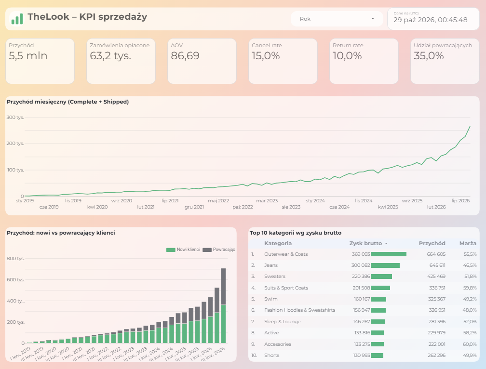

# TheLook – analityka e-commerce

Analiza sklepu odzieżowego TheLook (publiczny zbiór `bigquery-public-data.thelook_ecommerce` w BigQuery):
od jakości danych i zachowań klientów, przez lejek zakupowy, po wnioski dla budżetu reklamowego.
Dashboard w Looker Studio liczy się na bieżących danych, a odświeżanie i monitoring działają automatycznie w GitHub Actions.

**Pytanie biznesowe:** z których źródeł ruchu przychodzą najbardziej wartościowi klienci, gdzie lejek traci kupujących
i w co warto inwestować?

## Dashboard

[Otwórz dashboard w Looker Studio](https://datastudio.google.com/reporting/68d592c6-9474-4409-b379-7127c6966f96)



Kafelek „Dane na” pokazuje najnowsze zamówienie w źródle – zbiór jest dopisywany codziennie, więc liczby się zmieniają.
Filtr „Rok” przelicza wszystkie wskaźniki i wykresy.

## Najważniejsze wnioski

1. **Kanał pozyskania nie różnicuje wartości klienta.** Revenue per user dla Search, Organic, Facebook, Email i Display
   mieści się w 56–58, a 95% przedziały ufności zachodzą na siebie. O podziale budżetu powinien więc decydować koszt
   pozyskania (CPA), a nie „jakość” ruchu.
2. **Ranking kategorii po przychodzie to nie ranking po zysku.** Marża brutto waha się od ~38% (Clothing Sets) do ~62%
   (Blazers & Jackets). Jeans są 2. w przychodzie przy marży 46,5%, Suits & Sport Coats 4. przy marży 59,8%.
   Kampanie warto oceniać na zysku brutto (POAS), nie na przychodzie.
3. **Co czwarta złotówka z zamówień przepada.** Anulowania i zwroty to 24,8% wartości zamówień; z każdych 100 zł
   rozstrzygniętych zamówień sklep zatrzymuje 69 zł. ROAS liczony na złożonych zamówieniach zawyża realny zwrot o ok. 45%.
   Anulowania (61% strat) kosztują więcej niż zwroty i da się im zapobiegać jeszcze przed wysyłką.
4. **Wzrost napędzają powracający klienci.** Przychód YTD 2026 jest o 72% wyższy r/r przy stałym AOV (~86) i stałej
   liczbie rejestracji (~1 040 miesięcznie). Udział powracających w przychodzie wzrósł z 3% (2019) do 46% (2026).
   Największym aktywem jest baza zarejestrowanych użytkowników – aktywacja i retargeting.
5. **Bez wspólnego słownika kanałów nie ma atrybucji.** Kanał pozyskania (`users`) i źródło sesji (`events`) używają
   różnych nazw (Search i Display tylko w `users`, Adwords i YouTube tylko w `events`) – zanim porównamy first
   i last touch, trzeba je uzgodnić.

Szczegóły, liczby i wykresy: notatniki `02`–`08`.

## Rekomendacje

Szacunki są orientacyjne – opierają się na danych historycznych i podanych założeniach, nie na wynikach testów.

| # | Rekomendacja | Uzasadnienie | Szacowany wpływ |
|---|---|---|---|
| 1 | Oceniać kampanie na przychodzie po anulowaniach i zwrotach, nie na wartości złożonych zamówień | Sklep zatrzymuje 69 zł ze 100 zł rozstrzygniętych zamówień | Realny ROAS = nominalny × 0,69 (ROAS 4,0 ≈ 2,8). Kampanie blisko progu opłacalności mogą w rzeczywistości przynosić stratę |
| 2 | Optymalizować budżet pod zysk brutto (POAS), z naciskiem na kategorie o wysokiej marży | Marża kategorii od ~38% do ~62%, ranking po przychodzie ≠ ranking po zysku | Ta sama złotówka przychodu w Blazers & Jackets daje ok. 60% więcej zysku brutto niż w Clothing Sets |
| 3 | Ograniczyć anulowania (płatność, dostępność, termin dostawy) | Anulowania to 61% strat i dzieją się przed wysyłką, więc łatwiej im zapobiec niż zwrotom | Każdy 1 pp mniej anulowań ≈ +1,8% przychodu, przy założeniu, że uratowane zamówienie zostaje zrealizowane |
| 4 | Aktywować zarejestrowanych, którzy jeszcze nie kupili (retargeting, CRM) | Ok. połowa zarejestrowanych nie złożyła zamówienia, a powracający dają już 46% przychodu | Aktywacja 5% z ok. 49 tys. niekupujących × AOV ~86 ≈ 210 tys. jednorazowo, czyli ok. 15% przychodu z 2025 r. (1,4 mln) |
| 5 | Ujednolicić słownik kanałów w `users` i `events` | Bez tego nie da się porównać first i last touch ani przypisać zakupów do kampanii | Warunek wiarygodnej atrybucji – bez bezpośredniego wpływu na przychód |

## Dalsze kroki

| Krok | Na czym polega | Co wnosi |
|---|---|---|
| Symulator kosztów reklam | Przyjęte stawki CPC per kanał (danych o kosztach w zbiorze nie ma) → koszt pozyskania klienta (CPA) i ROAS dla każdego kanału | Skoro wartość klienta jest w kanałach podobna, o budżecie decyduje koszt. Symulator pokazuje, jak zmienia się zysk przy przesunięciu budżetu między kanałami, i przekłada rekomendacje 1–2 na konkretne kwoty |
| Kafelek r/r w dashboardzie | Kolumna `revenue_prev_year` w widoku KPI, porównanie z tym samym okresem rok wcześniej | Dynamika wzrostu (+72% r/r) widoczna od razu, bez porównywania wykresów; działa z filtrem „Rok” |
| Kolejne strony dashboardu | Lejek zakupowy (sesje → produkt → koszyk → zakup) i segmenty klientów; widoki już istnieją | Odpowiedź na drugą część pytania biznesowego – gdzie odpadają kupujący – bez otwierania notatników |
| Test t Welcha | Test sprawdzający, czy dwie średnie (np. revenue per user w Search i Display) różnią się istotnie. Wersja Welcha nie zakłada równych wariancji ani równej liczebności grup – a Search ma 68 tys. użytkowników, Display niecałe 4 tys. | Nachodzenie się przedziałów ufności to test ostrożny: może przeoczyć małą, ale realną różnicę. Test Welcha daje wynik dla każdej pary kanałów (p-value) i mocniej uzasadnia wniosek „kanały nie różnią się” |
| Analiza kohortowa | Kohorta = klienci, którzy pierwszy raz kupili w tym samym miesiącu. Dla każdej kohorty liczymy, jaki odsetek kupuje ponownie po 1, 2, 3… miesiącach i ile przychodu przynosi łącznie (LTV) | Pokazuje, czy nowsi klienci wracają częściej czy rzadziej niż starsi, kiedy zwykle następuje drugi zakup (dobry moment na kampanię CRM) i ile wart jest klient w czasie – górny limit sensownego kosztu jego pozyskania |
| Snapshoty danych | Cykliczna kopia tabel źródłowych we własnym zbiorze BigQuery | Zbiór zmienia się także wstecz, więc ta sama analiza uruchomiona za tydzień daje inne liczby. Snapshot pozwala odtworzyć wynik i porównywać okresy na tych samych danych |
| Alerty i bezpieczniejsze logowanie | Powiadomienie o nieudanym przebiegu workflow; logowanie GitHub Actions przez Workload Identity Federation (krótkotrwały token zamiast stałego klucza) | Awaria pipeline'u nie przejdzie niezauważona; brak klucza, który mógłby wyciec i dawać bezterminowy dostęp do projektu |
| Aplikacja i asystent danych | Dashboard w Streamlit oraz asystent: pytanie po polsku → zapytanie SQL (tylko odczyt, z limitem kosztu, z pokazanym SQL) → wynik | Szybkie odpowiedzi na pytania spoza dashboardu bez pisania SQL, z możliwością sprawdzenia, jak wynik został policzony |

## Jak to działa

```
bigquery-public-data.thelook_ecommerce          (dane źródłowe, dopisywane codziennie)
        │
        ├── notatniki EDA (Python + pandas)     analiza jednorazowa, wyniki zapisane w notatnikach
        │
        └── widoki w zbiorze marts (SQL)        liczone przy każdym odczycie
                │
                └── Looker Studio               dashboard, cache 1 h

GitHub Actions
  freshness.yml   codziennie: liczba rekordów i najnowsza data w tabelach źródłowych -> monitoring.data_freshness
  views.yml       po zmianie SQL i co tydzień: odtworzenie widoków (w sandboxie BigQuery wygasają po 60 dniach)
```

## Zawartość repozytorium

| Plik / katalog | Opis |
|---|---|
| `01_channel_value.ipynb` | Wartość klienta wg kanału pozyskania, przedziały ufności |
| `02_eda_data_quality.ipynb` | Jakość danych: braki, duplikaty, spójność dat i statusów |
| `04_eda_customers.ipynb` | Klienci: płeć, wiek, kraje, kanały |
| `05_eda_products.ipynb` | Produkty: kategorie, marki, ceny, marża, analiza Pareto |
| `06_eda_orders_time.ipynb` | Zamówienia w czasie: trend, sezonowość, nowi vs powracający |
| `07_eda_cancellations_returns.ipynb` | Anulowania i zwroty: skala strat, istotność różnic między segmentami |
| `08_eda_events_funnel.ipynb` | Lejek zakupowy, ścieżki w sesji, atrybucja |
| `sql/views/` | Widoki BigQuery zasilające dashboard |
| `deploy_views.py` | Tworzy / aktualizuje widoki z plików SQL |
| `03_freshness_log.py` | Log świeżości danych |
| `bq_utils.py` | Klient BigQuery, `run_query()` z szacowaniem kosztu i limitem 1 GB, `read_bq()` |
| `viz_style.py` | Wspólny styl wykresów |
| `.github/workflows/` | Harmonogramy GitHub Actions |

## Definicje

- **Przychód** – suma `sale_price` pozycji z zamówień o statusie Complete lub Shipped.
- **AOV** – przychód / liczba zamówień liczonych do przychodu.
- **Cancel rate / Return rate** – odsetek wszystkich zamówień ze statusem Cancelled / Returned.
- **Klient powracający** – drugie i kolejne zamówienie tego samego klienta.
- Daty z `orders.created_at` (`order_items.created_at` bywa późniejsze niż data wysyłki), analizy w czasie tylko na pełnych miesiącach.

## Uruchomienie

Wymagany projekt w Google Cloud (wystarczy darmowy BigQuery sandbox) i Google Cloud CLI.

```bash
python -m venv .venv
.venv\Scripts\activate          # Windows; Linux/macOS: source .venv/bin/activate
pip install -r requirements.txt
gcloud auth application-default login
```

Następnie w `bq_utils.py` ustaw `PROJECT_ID` na własny projekt. Notatniki uruchamia się komórka po komórce,
widoki tworzy `python deploy_views.py`.

GitHub Actions loguje się kontem usługi (role: BigQuery Job User, BigQuery Data Editor, BigQuery Read Session User);
klucz jest przechowywany wyłącznie jako sekret repozytorium.

## Ograniczenia

Dane są syntetyczne. Część zależności wygląda na losową (kanał pozyskania, status zamówienia), część jest nierealistyczna
(ok. 51% zarejestrowanych kupuje, mediana od rejestracji do pierwszego zakupu to ponad rok, zalogowane sesje kupują
w 99,8%). Brakuje danych o kosztach reklam, więc ROAS i CPA można liczyć tylko na przyjętych założeniach.
Zbiór zmienia się codziennie, także wstecz – wyniki w notatnikach mają zapisany moment pobrania danych.

## Technologie

BigQuery (SQL), Python (pandas, matplotlib, google-cloud-bigquery), Looker Studio, GitHub Actions, Git.
